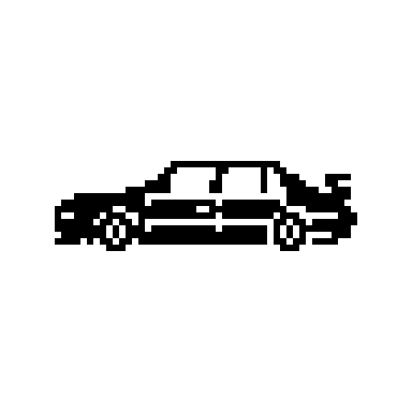

# Drive HUD

> [!WARNING]
> **This app is still in development.** It probably has bugs and things that are awkward to use. Please [report problems and suggest improvements](https://github.com/V-1per/hud/issues/new/choose): every report helps.

A head-up display for any car: the phone lies on the dashboard and its screen reflects on the windscreen. Navigation works offline, with its own maps and routing (OpenStreetMap data), in English, Portuguese, Spanish, French, German or Italian.

This repository only holds the **files and versions** of the app. The source code is private. The app is free to use; the texts and images in this repository are under [CC BY 4.0](LICENSE).

## Is this for me?

- **Your phone:** Android 6 or newer. A phone with 6 GB of memory or more handles a whole country; one region (Portugal, an Italian region…) runs on less.
- **Your car:** any car. The phone lies on the dashboard and its screen reflects on the windscreen; a cheap HUD reflective film makes it much clearer in daylight.
- **Countries with maps:** Portugal (with Azores and Madeira), Spain (with Balearic and Canary Islands), Andorra, Italy (5 regions) and the Netherlands. The BETA (2.4.2) adds France (5 regions), Belgium, Luxembourg, Switzerland and Austria. More are coming.
- **Offline:** maps, routes, search and the HUD work without internet once the maps are downloaded. Internet is only used for downloading maps and updates.
- **Calls, messages and music:** shown on the HUD; calls are answered with the car's or headset's button, so you never touch the phone.
- **Try it first:** [open it in your browser](https://v-1per.github.io/hud/) with the maps of Portugal and a simulated drive, no install.
- **Stable or BETA:** the *latest release* has been tested on real drives; a *BETA* has the newest changes and may still have bugs (see [Versions](#versions)).
- **Privacy:** no account, no ads, no analytics. See [Privacy](PRIVACY.md).

## Downloads

- **Android app**: the `HUD.apk` file of the [latest release](https://github.com/V-1per/hud/releases/latest) (2.2.8.7). It is not on the Play Store yet: see [Installing on Android](#installing-on-android), including what to do if Play Protect or the phone blocks it. From 2.2.8.6 on the app is signed with its permanent key: coming from an older version, uninstall it once first (save your places, trips and cars with *Settings › Your data › Export*, then *Import* them). Later versions install over it as usual.
- **Android app, BETA** (newest changes, not yet tested on real drives): the `HUD.apk` file of [2.4.2 BETA](https://github.com/V-1per/hud/releases/tag/v2.4.2), with driving without a destination, the new countries, the cloud copy of your data and wrong-limit reports. It installs over 2.2.8.6 or 2.2.8.7. If something goes wrong, [report it](https://github.com/V-1per/hud/issues/new/choose) and go back to the latest release.
- **Try it in the browser**: [v-1per.github.io/hud](https://v-1per.github.io/hud/) opens the app online, with the maps of Portugal and a simulated drive (no install).
- **PC (Windows, developer version)**: `Drive-HUD-PC-DEV-2.2.8.7.zip` in the [latest release](https://github.com/V-1per/hud/releases/latest), or `Drive-HUD-PC-DEV-2.4.2-BETA.zip` in the [BETA](https://github.com/V-1per/hud/releases/tag/v2.4.2). Unzip it and run `Drive HUD.exe`. It includes trip simulation.
- **Map packs**: release [`maps`](https://github.com/V-1per/hud/releases/tag/maps). The app downloads them itself the first time it opens: you choose the countries. Available now (with cemeteries, lakes, bays, capes and nature reserves since November 2026): Portugal (mainland 29 MB, Azores, Madeira), Spain (mainland 99 MB, Balearic and Canary Islands), Andorra, Italy in 5 regions (North-west, North-east, Centre, South, Islands; 20–41 MB each) and the Netherlands (74 MB). With the BETA also France in 5 regions (North-west, North-east, Île-de-France, South-west, South-east; 21–77 MB each), Belgium (39 MB), Luxembourg (2 MB), Switzerland (33 MB) and Austria (42 MB), and the speed bumps on every map.

## Installing on Android

The app is not on the Play Store yet, so Android shows some warnings the first time. This is normal for any app installed from outside the store. Download the APK **only from this page**.

1. On the phone, open the [latest release](https://github.com/V-1per/hud/releases/latest) and tap `HUD.apk`. If the browser says the file "might be harmful", tap **Download anyway**.
2. Open the downloaded file. If Android says installing from this source is not allowed, tap **Settings**, switch on **Allow from this source**, and go back.
3. Tap **Install**.

Installing over an older version keeps your saved places and trips.

### If Google Play Protect blocks it

Play Protect blocks apps it does not know yet ("Blocked by Play Protect" or "Unsafe app blocked").

1. On the warning, tap **More details** (sometimes a small arrow).
2. Tap **Install anyway**.

If there is no "Install anyway" option:

1. Open the **Play Store**, tap your profile picture (top right) and then **Play Protect**.
2. Tap the gear icon and switch off **Scan apps with Play Protect**.
3. Install `HUD.apk`.
4. **Switch Play Protect back on** straight after.

### If the phone's own blocker stops the installation

Some phones have their own installation blocker that stops every app from outside the store, even before Play Protect. On Samsung (One UI 6 or newer) it is called **Auto Blocker**, and the message says the installation was blocked by Auto Blocker.

1. Open **Settings → Security and privacy → Auto Blocker**.
2. Switch it **off**.
3. Install `HUD.apk`.
4. **Switch Auto Blocker back on** straight after. The app keeps working with it on.

Other brands have similar options, usually under Settings → Security (for example a "security scan" before installing): allow the installation, then switch the protection back on.

### Other messages

- **"App not installed"**: check that the phone has free space. If you installed a copy of the app that you got from someone else, uninstall it first.
- Still stuck? [Open an issue](https://github.com/V-1per/hud/issues/new/choose) with the exact message (a screenshot helps) and the phone model.

## Privacy

No account, no ads, no analytics: what you do in the app stays on your phone. What goes online and why, and each Android permission: [Privacy](PRIVACY.md).

## Problems and suggestions

Open an [issue](https://github.com/V-1per/hud/issues/new/choose) (a free GitHub account is needed): "Report a problem" for something that goes wrong, "Suggest an improvement" for ideas. The app has the same link in **Settings → Problems and suggestions**. Say which phone (or PC) you use and the app version (also in Settings).

## Community

The people who helped most, by reporting problems and suggesting ideas: see the [community leaderboard](COMMUNITY.md). 🏆

## Roadmap

What is coming next, in order: see the [roadmap](ROADMAP.md).

## Versions

The newest version may be a **BETA**: it has the latest changes but has not been tested on real drives yet. The version below it is the latest tested one. Using a beta and [reporting problems](https://github.com/V-1per/hud/issues/new/choose) helps fix them before the official release.

| Version | Name | In short | |
|---|---|---|---|
| **2.4.2 BETA** | Open Road | Drive without a destination: tap *Start drive* and the HUD follows the road you are on. With everything from 2.4.1 Second Look: an encrypted copy of your data in the cloud, restored with a recovery code; wrong speed limits reported after a trip; fewer wrong limits on city avenues; and from 2.3 Borderless: France, Belgium, Luxembourg, Switzerland and Austria; towns found in countries whose map you don't have; speed bump warnings; fewer false speeding alarms; an automatic copy of your data; recordings sent to the developer with one tap; a new icon. |  |
| **2.2.8.7** | Green Light | A guide that gets every feature working; updates that install from inside the app; lighter maps; sounds at speed cameras; pedestrian streets and the Netherlands on the map; routes to and from car-free centres; WhatsApp calls answered from the car; encrypted trip recordings sent through GitHub; the app's permanent signing key. |  |
| 2.2.7.2 | Back Roads | New maps with the streets that were missing; map updates; avoid motorways and dirt roads; speeding warning levels; answer calls with the car's button; send trip recordings; new version notice. |  |
| 2.2.6 | Pit Lane | A garage for your cars, with each car's speedometer; no pop-ups over the HUD while driving. |  |
| 2.2.5.5 | Hold On | The HUD stops when the car stops in a tunnel; call waiting on the HUD card. |  |
| 2.2.5.4 | Clean Slate | Saved HUD colours can be deleted. |  |
| 2.2.5.3 | Smooth Glide | The planning map drags and zooms smoothly. |  |
| 2.2.5.2 | Name Tag | The version shown while the app opens and at the bottom of Settings. |  |
| 2.2.5.1 | True Colours | Colours that keep each style's shades, text colour, saved colours, HEX codes; text size for text only. |  |
| 2.2.5 | Make It Yours | HUD customiser: live preview and a colour wheel; a cleaner screen while driving. |  |
| 2.2.4 | Long Live the HUD! | Longer battery: automatic brightness and lighter drawing. |  |
| 2.2.3 | Second Opinion | Call fixes for Android 15; capes and landmarks first in search. |  |
| 2.2.2 | Back on Track | Smarter rerouting, no more false "Recalculating". |  |
| 2.2.1 | Pick Up! | The HUD comes back as soon as you answer; call timer. |  |
| 2.2 | Ring Ring | Calls and messages fixed; PC version and online preview. |  |
| 2.1 | Fine Tuning | Faster rerouting, lighter maps, calls on the HUD. |  |
| 2.0 | Pick Your World | Choose the countries you want; routes across borders. |  |
| 1.16 | Easy Does It | Easier to use: place cards, "Where to?" bar. |  |
| 1.15 | Learns Your Way | Arrival times that learn from you; saving mode. |  |
| 1.14 | Pit Stop | Up to 3 stops; search along the route. |  |
| 1.13 | Other Ways | House numbers and post codes; alternative routes. |  |
| 1.12 | Take the Exit | Exit signs, lane guidance, tunnels. |  |
| 1.11 | Less Is More | Four weaker HUD styles removed. |  |
| 1.10 | Race Day | Two more HUD styles. |  |
| 1.9 | Turn It Up | Music and visualizer on the HUD. |  |
| 1.8 | Game On | Video game HUD styles. |  |
| 1.7 | New Look | New Modern HUD layout; two retro styles. |  |
| 1.6 | Like a Map App | Search bar, quick filters, map types. |  |
| 1.5 | Drive HUD | New look and name: Drive HUD. |  |
| 1.4 | More to Find | Sea, rivers and parks; much better search. |  |
| 1.3 | First Drive | Fixes after the first test drive. |  |
| 1.2 | Signal Lost | "No GPS" warning; mini-map zoom. |  |
| 1.1 | Know the Limits | Speed limits, cameras, avoid tolls. |  |
| 1.0 | Hello, Road | First version: offline Portugal, own routing, the HUD. |  |

## Credits

Map data © [OpenStreetMap](https://www.openstreetmap.org/copyright) contributors, available under the Open Database License (ODbL). Sea from the [osmdata.openstreetmap.de](https://osmdata.openstreetmap.de) water polygons (ODbL). Flags from [flag-icons](https://github.com/lipis/flag-icons) (MIT).

The app itself is © its author, all rights reserved.
